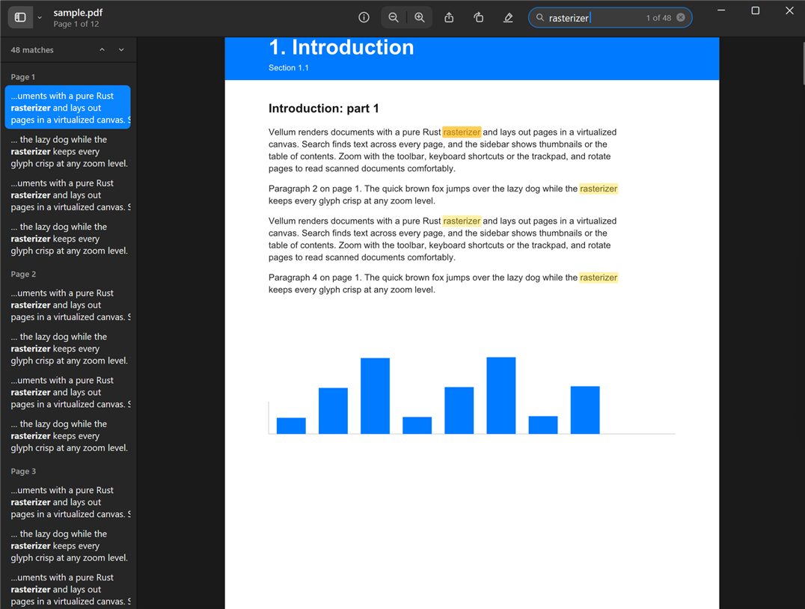

# Vellum

A fast, good-looking PDF viewer inspired by macOS Preview, written in Rust with
[GPUI](https://github.com/zed-industries/zed/tree/main/crates/gpui) (Zed's UI framework, used straight from the Zed
repo) and the pure-Rust [hayro](https://github.com/LaurenzV/hayro) rasterizer. No native PDF libraries, no web view.



## Features

- **Preview-style window** — unified toolbar (sidebar + view menu, title with "Page X of Y", info, zoom, share,
  rotate, highlight, search), flat design with system light/dark colors, native Windows caption buttons
  (with Snap Layouts) and native traffic lights on macOS
- **Sidebar** — page thumbnails, a collapsible table of contents that tracks where you are, and search results
  with context
- **Reading** — continuous scroll, single page and two-page layouts; zoom to fit, actual size, Ctrl/⌘+wheel and
  pinch anchored to the cursor; rotate; go to page
- **Text** — search with highlighted matches, drag-select (double-click word, triple-click line) and copy,
  highlight annotations (in memory)
- **Sharp at any zoom** — pages are rendered at the display's exact pixel density and placed on whole device
  pixels, so text maps 1:1 onto the screen; past 24 MP a page switches to 1024 px tiles covering only what's
  visible, so it stays crisp up to 1600% without memory growing with zoom
- **Smooth** — browser-style eased scrolling (100 px per wheel notch, like Chromium), pages rendered on a
  background pool nearest-to-screen first with large pages rasterized across several threads, thumbnails as
  instant placeholders, search off the UI thread, virtualized lists; frame work stays well under a millisecond
  on 1000-page documents
- **Robust text** — fonts a PDF references but doesn't embed (common in Windows-generated forms) are loaded from
  the system (Times New Roman, Arial, Courier New), so Cyrillic and other non-Latin text renders
- Inspector with document info, open via dialog, command line, drag and drop, or Explorer's "Open with"

## Build and run

Requires a recent stable Rust toolchain.

```
cargo run --release -- path/to/file.pdf
```

On Windows, if the project lives in a deeply nested folder you may hit the 260-character path limit while
linking; point cargo at a short build directory, e.g. `set CARGO_TARGET_DIR=C:\vellum-target`.

`python tools/make_sample.py sample.pdf` regenerates the bundled test document, and `python tools/make_icon.py`
regenerates the app icon.

## Install on Windows

```
powershell -ExecutionPolicy Bypass -File tools\install-windows.ps1
```

Builds a release exe, copies it to `%LOCALAPPDATA%\Programs\Vellum`, adds a Start menu entry and registers it for
`.pdf` files (per-user, no admin rights). Then right-click any PDF → **Open with → Vellum** (tick "Always" to make
it the default), or pick it under **Settings → Apps → Default apps**. Undo with `tools\uninstall-windows.ps1`.

## Shortcuts (Ctrl on Windows/Linux, ⌘ on macOS)

| | |
|---|---|
| Open | Ctrl+O |
| Zoom in / out / actual size / fit | Ctrl+= / Ctrl+- / Ctrl+0 / Ctrl+9 |
| Rotate left / right | Ctrl+L / Ctrl+R |
| Hide sidebar / Thumbnails / Contents | Ctrl+Alt+1 / 2 / 3 |
| Continuous / Single / Two pages | Ctrl+1 / 2 / 3 |
| Find / next / previous | Ctrl+F / Ctrl+G (F3) / Ctrl+Shift+G (Shift+F3) |
| Inspector / Go to Page | Ctrl+I / Ctrl+Alt+G |
| Copy selection | Ctrl+C |
| Page navigation | ←/→, PgUp/PgDn, Home/End, Space |

`VELLUM_APPEARANCE=light` or `dark` overrides the system appearance.

## Limitations

- Encrypted / password-protected PDFs aren't supported yet (hayro limitation).
- Highlights aren't saved back to the file.
- Developed and tested on Windows 11. GPUI also targets macOS and Linux, and the code has paths for both
  (native traffic lights, Liberation/Apple system fonts), but they haven't been built or tested yet.

## License

Licensed under either of [Apache License, Version 2.0](LICENSE-APACHE) or [MIT license](LICENSE-MIT) at your
option.

Unless you explicitly state otherwise, any contribution intentionally submitted for inclusion in this project by
you, as defined in the Apache-2.0 license, shall be dual licensed as above, without any additional terms or
conditions.
